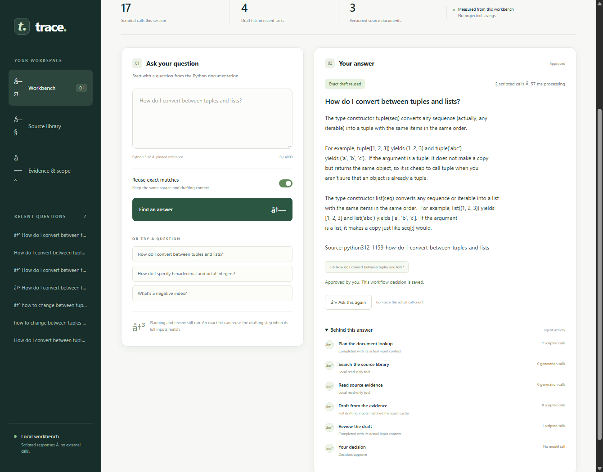

# Adaptive Agentic Semantic Cache

[](https://www.python.org/)
[](https://opensource.org/licenses/MIT)
[](tests/)
[](artifacts/resume/)
[](docs/CURRENT_STATUS.md)

> **A production-principled hybrid caching gateway and inspectable documentation agent** combining O(1) exact hash lookups, deterministic structural & directional constraint guards, and cross-encoder answer verification with rigorous negative results reporting and human-in-the-loop admission.

---

## The Problem: The Cost & Safety Dilemma in Agentic Systems

Autonomous LLM agents do not just answer questions—they execute multi-step workflows. A single documentation request routinely triggers **supervisor planning, local tool invocations (search and read), specialist draft generation, and reviewer verification**, consuming 3x to 5x the provider calls of a standard conversational interface. In documentation and support workloads, repetitive questions waste significant computational budget.

However, **naive semantic caching (e.g. cosine distance over prompt embeddings) fails dangerously in agentic workflows**:
1. **Subtle Intent Shifts & Inverse Operations:** A query asking *"How do I convert a list to a tuple?"* has near-identical vector similarity to *"How do I convert a tuple to a list?"*, but returning the cached answer is completely wrong.
2. **Missing Constraint Awareness:** Prompts asking for *"executable code snippets"* or *"recursive deep copies"* get falsely matched to general conceptual summaries.
3. **Stale Scope & Multi-Tenant Leakage:** Unchecked caching risks serving answers across different access boundaries, tenant epochs, or modified documentation revisions.
4. **Uncalibrated Confidence:** Vector distance does not measure answer correctness.

### The Solution: Multi-Tier Guarded Caching

This project implements a multi-tier, safe-by-default architecture:
- **Tier 0 (Safe Default Exact Cache):** Immediate O(1) SQLite lookup bound to tenant epoch, source revision, and runtime parameters. Serves cache hits with **zero provider calls**.
- **Structural & Directional Guards:** Deterministic pre-inference checks that block inverse operations, directional reversals, numeric/version constraints, and missing code examples before any neural model is called.
- **Bounded Documentation Agent:** Inspectable orchestration with tool sandboxing, specialist drafting, reviewer verification, and durable human approval.
- **Experimental Guarded Semantic Reuse:** Dense top-k retrieval (`all-MiniLM-L6-v2`) and cross-encoder answer verification (`ms-marco-MiniLM-L-6-v2`), safely constrained to shadow mode by default and explicit opt-in for research.

---

## Interactive Documentation Workbench

The system includes a local visual workbench demonstrating the entire agent workflow, document citations, real-time cache tier decisions, and operator approval controls:



*The workbench in action: An exact repeat query triggers a Tier 0 cache hit (`Exact draft reused`, 2 scripted calls avoided, 57 ms processing). The right panel exposes the full agent execution timeline: Plan the document lookup → Search the source library → Read source evidence → Draft from evidence (exact cache hit) → Review the draft → Human operator approval decision.*

---

## Architecture & Data Flow


---

## Implemented Engineering Components

- **Scoped LLM Response Cache Gateway:** Multi-tenant SQLite store, cryptographic fingerprinting, TTL expiration, transactional invalidation, and strict payload bounds (`src/policy/`).
- **Deterministic Guard Engine:** Regex- and taxonomy-based checks for inverse operations, directional conversions, polarity/negations, and executable code example requirements (`src/classifier/`).
- **Bounded Document Agent Orchestrator:** Multi-role workflow (supervisor, tools, drafter, reviewer), structured tool schema, checkpoint persistence, and approval state machine (`src/agents/document_agent.py`).
- **Cross-Encoder Answer Verifier:** Answer-aware semantic verification comparing candidate answers against query intent (`src/decision/`).
- **Local Visual Workbench & CLI Runner:** Interactive web UI (`scripts/run_demo.py`) and automated 7-scenario flagship CLI test (`scripts/run_demo.py --cli`).

---

## Reconciled Benchmark Results & Work Avoidance

Large-scale evaluations across **25 documentation source groups** and **125 distinct base intents** evaluated all 4 matched caching arms under identical event order and approval workflow (full analysis in [METRICS_RESULTS.md](docs/METRICS_RESULTS.md), FACTS MC-01–MC-16):

### Headline Work Avoidance Results

- **Repeat-Rich Workload (Profile A, 600 events):**
  - **47.33% Provider Call Avoidance:** Avoided **852 provider invocations** out of 1,800 baseline calls.
  - **46.57%–47.72% Synthetic Token Reduction:** Reduced synthetic token consumption from 201,667 to 105,429.
  - **98.33% Exact Repeat Coverage:** Successfully intercepted 284 exact repeats with zero provider calls.
  - **0 Adversarial False Accepts** across 120 adversarial challenges (`[0.00%, 3.03%]` exact 95% CI).

- **Lower-Repeat Breadth Workload (Profile B, 400 events across ALL 25 groups):**
  - **14.75% Provider Call Avoidance:** Avoided **177 provider invocations** out of 1,200 baseline calls.
  - **14.56%–18.41% Synthetic Token Reduction:** Reduced synthetic tokens from 133,964 to 109,302.
  - **98.33% Exact Repeat Coverage:** Intercepted 59 exact repeats with zero provider calls.

### Crucial Scientific Disclosures & Honest Limits

1. **Overall Application Latency Did Not Improve in Offline Replay:**
   - In Profile A, whole-agent p50 latency was **130.86 ms** for `no_cache` vs **140.80 ms** for `exact_only`.
   - In Profile B, whole-agent p50 latency was **89.70 ms** for `no_cache` vs **168.42 ms** for `exact_only`.
   - *Why?* Because offline reference agent execution is lightweight and instantaneous (sub-150 ms), cache lookups, database serialization, and orchestration checks introduce slight overhead. While caching saves seconds over real multi-second remote LLM network roundtrips, it does *not* reduce whole-agent latency in fast offline simulations.
2. **Semantic Reuse Has Documented Quality Limitations:**
   - Independent P2 frozen evaluation revealed that **36.0% (9/25)** of semantic accepts were insufficient under model-assisted review (7 missing requested executable examples, 2 wrong-operation/inverse reuse).
   - In the untuned 400-event breadth study, guarded semantic mode accepted 1 adversarial challenge (`async_05:challenge_added_requirements`).
   - Consequently, **exact caching is enforced as the safe default serving mode (`mode="exact"`)**, and neural semantic reuse remains strictly experimental.

### Detailed Evaluation Tables

#### Profile A: Repeat-Rich Workload (600 Events per Arm; 12 Executed Groups, 60 Base Intents)
*Models high query redundancy (4x exact repeats, 3x paraphrases) across 12 source groups.*

| Metric | Baseline: `no_cache` | `exact_only` *(Safe Default)* | `verified_semantic` *(Guarded Opt-In)* | `shadow_semantic` *(Diagnostic)* |
| :--- | :---: | :---: | :---: | :---: |
| **Serving Configuration** | `mode="off"` | `mode="exact"` | `mode="guarded"` | `mode="shadow"` |
| **Evaluated Events** | 600 | 600 | 600 | 600 |
| **Total Provider Invocations** | 1,800 | 948 | **927** | 948 |
| **Calls Avoided on Eligible Reuse** | 0 | **852 (47.33%)** | **873 (48.50%)** | **852 (47.33%)** |
| **Calls Avoided on Ineligible Reuse** | 0 | **0** | **0** | **0** |
| **Synthetic Token Volume** *(Offline)* | 201,667 | 107,750 | **105,429** | 107,750 |
| **Synthetic Token Reduction** | 0.0% | 46.57% | **47.72%** | 46.57% |
| **Cache Hits Total** | 0 | 284 | **291** | 284 |
| - *Exact Hits (Tier 0)* | 0 | 284 | 273 | 284 |
| - *Verified Semantic Hits (Tier 1)* | 0 | 0 | **18** | 0 |
| **Exact Repeat Coverage** | 0.0% | **98.33%** | **98.33%** | **98.33%** |
| **Paraphrase Opportunity Coverage** | 0.0% | 26.67% | **29.44%** | 26.67% |
| **Adversarial Challenges Tested** | 120 | 120 | 120 | 120 |
| **Adversarial False Accepts** | 0 | **0** | **0** *(dev regression)* | **0** |
| **Exact 95% Clopper-Pearson CI** | `[0.00%, 3.03%]` | `[0.00%, 3.03%]` | `[0.00%, 3.03%]` | `[0.00%, 3.03%]` |
| **Whole-Agent Latency p50** | 130.86 ms | 140.80 ms | 137.81 ms | 141.58 ms |
| **Whole-Agent Latency p95** | 151.58 ms | 233.14 ms | 237.73 ms | 241.28 ms |

#### Profile B: Lower-Repeat Breadth Workload (400 Events per Arm; ALL 25 Groups, 125 Base Intents)
*Models broad exploratory traffic across all 25 documentation groups, executed without further tuning.*

| Metric | Baseline: `no_cache` | `exact_only` *(Safe Default)* | `verified_semantic` *(Guarded Opt-In)* | `shadow_semantic` *(Diagnostic)* |
| :--- | :---: | :---: | :---: | :---: |
| **Serving Configuration** | `mode="off"` | `mode="exact"` | `mode="guarded"` | `mode="shadow"` |
| **Evaluated Events** | 400 | 400 | 400 | 400 |
| **Total Provider Invocations** | 1,200 | 1,023 | **975** | 1,023 |
| **Calls Avoided on Eligible Reuse** | 0 | **177 (14.75%)** | **222 (18.50%)** | **177 (14.75%)** |
| **Synthetic Token Volume** *(Offline)* | 133,964 | 114,453 | **109,302** | 114,453 |
| **Synthetic Token Reduction** | 0.0% | 14.56% | **18.41%** | 14.56% |
| **Cache Hits Total** | 0 | 59 | **75** | 59 |
| - *Exact Hits (Tier 0)* | 0 | 59 | 57 | 59 |
| - *Verified Semantic Hits (Tier 1)* | 0 | 0 | **18** | 0 |
| **Exact Repeat Coverage** | 0.0% | **98.33%** | **98.33%** | **98.33%** |
| **Paraphrase Opportunity Coverage** | 0.0% | 0.00% | **10.00%** | 0.00% |
| **Adversarial Challenges Tested** | 125 | 125 | 125 | 125 |
| **Adversarial False Accepts** | 0 | **0** | **1** | **0** |
| **Exact 95% Clopper-Pearson CI** | `[0.00%, 2.91%]` | `[0.00%, 2.91%]` | `[0.02%, 4.38%]` | `[0.00%, 2.91%]` |
| **Whole-Agent Latency p50** | 89.70 ms | 168.42 ms | 180.60 ms | 183.55 ms |
| **Whole-Agent Latency p95** | 103.71 ms | 194.46 ms | 219.77 ms | 224.81 ms |

---

## Quickstart & Verification Demo

### 1. Environment Setup

```bash
# Clone repository
git clone https://github.com/paridhik11/adaptive-agentic-semantic-cache.git
cd adaptive-agentic-semantic-cache

# Create and activate virtual environment
python -m venv .venv
source .venv/bin/activate  # On Windows: .venv\Scripts\activate

# Install dependencies
pip install -e ".[dev]"
```

### 2. Run the Flagship Verification Demo (7 Scenarios + Evidence Summary)

Execute the automated CLI demo to witness all 7 lifecycle execution scenarios followed by the Criterion 8 verification table:

```bash
python scripts/run_demo.py --cli
```

**Lifecycle Execution Scenarios Validated:**
1. **Fresh Request:** Passes through supervisor planning, tool retrieval, drafting, and reviewer verification (3 provider calls, status `AWAITING_APPROVAL`).
2. **Operator Approval & Admission:** Operator approves draft; admitted to durable SQLite storage (`COMPLETED`, 0 provider calls).
3. **Safe Default Exact Repeat:** Immediate Tier 0 exact hit under default configuration (0 provider calls, 3 calls avoided, ~28 ms).
4. **Paraphrase Query Behavior:** Under default exact serving, paraphrase query misses and runs fresh execution without substituting experimental semantic answers (3 provider calls, 0 avoided).
5. **Changed Requirement (Fail Closed):** Direction reversal and inverse operations rejected by structural guard; fails closed to fresh execution (3 provider calls).
6. **Scope Invalidation:** Tenant epoch incremented; subsequent request safely misses and runs fresh work (3 provider calls).
7. **Restart Persistence:** Clean agent instance re-initialized from SQLite databases; verified answers survive process restarts with zero corrupt state.

*Optional: To opt into experimental guarded semantic reuse, run `python scripts/run_demo.py --cli --experimental-semantic`.*

### 3. Launch Local Web Workbench

To interact with the visual documentation assistant:

```bash
python scripts/run_demo.py
```
Open [http://127.0.0.1:8765](http://127.0.0.1:8765) in your browser.

### 4. Run Reproducible Benchmark Fixtures

```bash
python scripts/benchmark_whole_agent.py --workload both
```

### 5. Run Test Suite

```bash
pytest tests/test_release_correction.py tests/test_p1_acceptance.py tests/test_hybrid_cache.py tests/test_harness_acceptance_8.py tests/test_workbench.py
```

---

## Detailed Audits, Research History & Provenance

### Independent P2 Frozen Neural Evaluation Findings

Independent frozen P2 neural evaluation was executed against checkpoint `4f9858e` by ChatGPT Work using real local neural inference (DenseEncoder + LocalPassageScorer):

- **Evaluation Workload:** 144 requests across 12 documentation groups.
- **Semantic Accepts:** 25 semantic answers accepted by cross-encoder threshold.
- **Provisional Sufficiency:** 16 / 25 accepts (64.0%, exact 95% Clopper-Pearson CI [42.5%, 82.0%]) provisionally sufficient under model-assisted review.
- **Insufficient Accepts:** 9 / 25 accepts (36.0%, exact 95% Clopper-Pearson CI [18.0%, 57.5%]) insufficient under model-assisted review.
- **Failure Root Causes:** 7 failures involving missing explicitly requested executable examples; 2 failures involving wrong-operation reuse (e.g. inverse operations).
- **Scope Challenges:** 0 hits across 60 scope challenges (0.0%, exact 95% Clopper-Pearson CI [0.0%, 6.0%]).
- **Assessment:** Failed safety qualification, not a production precision result. There is no claim of 98% precision, independent human truth, or live API monetary savings. Neural relevance scores are treated as uncalibrated relevance signals rather than guarantees of correctness.

### 24-Task Scripted Benchmark Fixtures (Engineering Baseline)

Across standardized 24-task whole-agent workloads encompassing supervisor planning, document tool reads, draft generation, reviewer verification, and terminal SQLite state persistence under reference replay:

| Workload Profile *(Synthetic Reference)* | Arm | Provider Calls | Calls Avoided | Token Savings *(Offline)* | Whole-Agent p50 Latency | Opportunity Coverage | Adversarial False Hits |
| :--- | :--- | :---: | :---: | :---: | :---: | :---: | :---: |
| **Realistic Mixed Traffic**<br>*(6 seeds, 6 exact repeats, 6 safe paraphrases, 6 adversarial)* | **No Cache**<br>**Exact Only**<br>**Verified Semantic (Opt-In)** | 72<br>57<br>**45** | 0<br>15<br>**27** | 0%<br>20.7%<br>**37.7%** | 133.4 ms<br>136.7 ms<br>**122.4 ms** | 0% / 0%<br>83.3% / 0%<br>**83.3% / 66.7%** | 0.0%<br>0.0%<br>**0.0%** |
| **Repeat-Rich Traffic**<br>*(3 seeds, 10 exact repeats, 9 safe paraphrases, 2 adversarial)* | **No Cache**<br>**Exact Only**<br>**Verified Semantic (Opt-In)** | 72<br>42<br>**18** | 0<br>30<br>**54** | 0%<br>41.5%<br>**75.1%** | 144.2 ms<br>134.1 ms<br>**43.9 ms** | 0% / 0%<br>100% / 0%<br>**100% / 88.9%** | 0.0%<br>0.0%<br>**0.0%** |

*Note: Telemetry recorded from reproducible offline reference agent simulation (`runs/whole_agent_benchmark_results.json`).*

### Latency Optimization (P4 Milestone)

Profiling revealed that unoptimized hybrid misses incurred a ~60 ms overhead from unconditional dense embedding generation (~28 ms) and cross-encoder scoring (~32 ms). 

Three narrow, safety-preserving optimizations were implemented:
1. **Candidate Presence Pre-check:** Checks for valid, unexpired candidates in the current tenant epoch before calling neural encoders, dropping candidate-empty miss overhead to 0.01 ms.
2. **Cheap Structural Guards Pre-filtering:** Filters candidates by model match, response format, and history length before dense top-k retrieval.
3. **Thread-Safe LRU Embedding & Score Cache:** Bounded in-memory caching for query embeddings and passage scores.

### Live Provider Evaluation (Opt-In Safety Boundary)

A hermetic runner is provided for live API benchmarking against free-tier upstream providers:

```bash
# Safety check mode (default: spend cap $0.00, zero live calls made)
python scripts/run_live_benchmark.py --check-only

# Opt-in live execution (strictly requires explicit flag, spend cap, and existing journal)
python scripts/run_live_benchmark.py --execute-live --spend-cap 0.00 --agent-workflow
```

**Safety Invariants & Safeguards:**
- Outbound requests are strictly allowlisted; paid fallbacks and caller-controlled routing parameters are rejected.
- Only free-tier models are allowlisted (`nvidia/nemotron-3-super-120b-a12b:free`, `meta-llama/llama-3.2-3b-instruct:free`).
- Zero-output ceiling safeguard: `max_output_tokens <= 0` is rejected during preflight and request sanitization.
- No live calls are made without explicit user instruction, spend cap, and valid environment credentials.

---

## Release Checklist & Tested Commit

- [x] Evaluated prototype release with experimental semantic serving; no unverified production claims.
- [x] Safe default exact-only serving configuration (`mode="exact"`).
- [x] Automatic neural semantic reuse shadow mode (`mode="shadow"`) for diagnostic logging without answer substitution.
- [x] Targeted semantic guardrails: executable example requirement/answer coverage and direction/inverse operation compatibility.
- [x] Complete whole-agent timing boundary (planning, tools, drafting, reviewer check, approval, admission, terminal SQLite persistence).
- [x] Atomic revalidation under lock for tenant epochs, scopes, TTL, and tombstones.
- [x] Latency optimization eliminating candidate-empty miss overhead.
- [x] Reproducible 7-scenario flagship verification demo with Criterion 8 evidence summary (`scripts/run_demo.py --cli`).
- [x] Matched efficiency benchmarks across mixed and repeat-rich synthetic workloads.
- [x] Strict opt-in live runner with zero-output ceiling check; zero live calls executed.
- [x] 100% passing acceptance and regression test suites.
