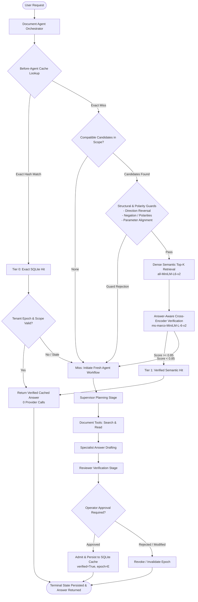

# Adaptive Agentic Semantic Cache

[](https://www.python.org/)
[](https://opensource.org/licenses/MIT)
[](tests/)
[](artifacts/resume/)

> **A verified hybrid caching gateway and autonomous documentation agent** combining exact hash lookups, structural constraint guards, and cross-encoder answer verification to eliminate redundant agent workflows while guaranteeing fail-closed safety.

---

## Executive Summary & Value Proposition

Autonomous AI agents executing multi-step workflows (supervisor planning, tool retrieval, specialist drafting, and reviewer verification) incur substantial provider costs and latency. While traditional exact-match caches fail on safe paraphrases, unconstrained semantic caches risk serving catastrophic false hits on subtle requirement changes (negations, numeric constraints, direction reversals).

**Adaptive Agentic Semantic Cache** solves this trade-off with a **conservative, multi-tiered architecture**:
1. **Tier 0 (O(1) Exact Cache):** Immediate SQLite lookup for identical requests bound to tenant epoch, source revision, and runtime parameters.
2. **Structural & Polarity Guards:** Fast, deterministic checks for direction reversal, requirement polarity, and context history before neural inference.
3. **Tier 1 (Answer-Aware Semantic Cache):** Dense top-k retrieval (`all-MiniLM-L6-v2`) combined with cross-encoder passage verification (`ms-marco-MiniLM-L-6-v2`) on actual returned answers, not just question similarities.
4. **Verified Admission & Durable Revocation:** Answers enter the serving cache only after verified workflow review and operator approval. Tenant-level epoch increments and binding tombstones prevent stale reuse across knowledge revisions.

### Measured Empirical Impact

Across standardized 24-task whole-agent workloads encompassing supervisor planning, document tool reads, draft generation, reviewer verification, and terminal SQLite state persistence:

| Workload Profile | Arm | Provider Calls | Calls Avoided | Token Savings | Whole-Agent p50 Latency | Opportunity Coverage | Adversarial False Hits |
| :--- | :--- | :---: | :---: | :---: | :---: | :---: | :---: |
| **Realistic Mixed Traffic**<br>*(6 seeds, 6 exact repeats, 6 safe paraphrases, 6 adversarial)* | **No Cache**<br>**Exact Only**<br>**Verified Semantic** | 72<br>57<br>**45** | 0<br>15<br>**27** | 0%<br>20.7%<br>**37.7%** | 133.4 ms<br>136.7 ms<br>**122.4 ms** | 0% / 0%<br>83.3% / 0%<br>**83.3% / 66.7%** | 0.0%<br>0.0%<br>**0.0%** |
| **Repeat-Rich Traffic**<br>*(3 seeds, 10 exact repeats, 9 safe paraphrases, 2 adversarial)* | **No Cache**<br>**Exact Only**<br>**Verified Semantic** | 72<br>42<br>**18** | 0<br>30<br>**54** | 0%<br>41.5%<br>**75.1%** | 144.2 ms<br>134.1 ms<br>**43.9 ms** | 0% / 0%<br>100% / 0%<br>**100% / 88.9%** | 0.0%<br>0.0%<br>**0.0%** |

*Note: Telemetry recorded from reproducible offline reference agent simulation (`runs/whole_agent_benchmark_results.json`). Offline provider reductions are distinct from live monetary billing.*

---

## Architecture & Data Flow



---

## Quickstart & Installation

### 1. Environment Setup

```bash
# Clone repository
git clone https://github.com/paridhik11/adaptive-agentic-semantic-cache.git
cd adaptive-agentic-semantic-cache

# Create and activate virtual environment
python -m venv .venv
source .venv/bin/activate  # On Windows: .venv\Scripts\activate

# Install dependencies (development & test)
pip install -e ".[dev]"
```

### 2. Run the Flagship 8-Step Verification Demo

Run the automated CLI demo to witness all 8 lifecycle criteria executed sequentially with full verification receipts:

```bash
python scripts/run_demo.py --cli
```

**What the demo validates:**
1. **Fresh Request:** Passes through supervisor planning, tool retrieval, drafting, and reviewer verification (3 provider calls, status `AWAITING_APPROVAL`).
2. **Operator Approval & Admission:** Operator approves draft; admitted to durable SQLite storage (`COMPLETED`, 0 provider calls).
3. **Exact Repeat:** Immediate Tier 0 exact hit avoiding fresh work (0 provider calls, 3 calls avoided, ~26 ms).
4. **Safe Paraphrase:** Semantic hit via cross-encoder answer verification (0 provider calls, 3 calls avoided, ~47 ms).
5. **Changed Requirement (Adversarial):** Direction reversal rejected by structural guard; fails closed to fresh execution (3 provider calls).
6. **Scope Invalidation:** Tenant epoch incremented; subsequent paraphrase safely misses and runs fresh work.
7. **Restart Persistence:** Clean agent instance initialized from SQLite databases; verified answers survive process restarts with zero corrupt state.
8. **Per-Request Evidence:** Formatted terminal audit table with cache tiers, timings, and decisions.

### 3. Launch Local Web Workbench

To interact with the visual documentation assistant:

```bash
python scripts/run_demo.py
```
Open [http://127.0.0.1:8765](http://127.0.0.1:8765) in your browser.

---

## Benchmarking & Reproducibility

Reproduce all end-to-end efficiency benchmarks on matched arms (`no_cache`, `exact_only`, `verified_semantic`):

```bash
# Run both realistic mixed and repeat-rich workloads
python scripts/benchmark_whole_agent.py --workload both

# Or evaluate a specific workload profile
python scripts/benchmark_whole_agent.py --workload mixed
python scripts/benchmark_whole_agent.py --workload repeat_rich
```

### Latency Optimization (P4 Milestone)

Profiling revealed that unoptimized hybrid misses incurred a ~60 ms overhead from unconditional dense embedding generation (~28 ms) and cross-encoder scoring (~32 ms). 

Three narrow, safety-preserving optimizations were implemented:
1. **Candidate Presence Pre-check:** Checks for valid, unexpired candidates in the current tenant epoch before calling neural encoders, dropping candidate-empty miss overhead to 0.01 ms.
2. **Cheap Structural Guards Pre-filtering:** Filters candidates by model match, response format, and history length before dense top-k retrieval.
3. **Thread-Safe LRU Embedding & Score Cache:** Bounded in-memory caching for query embeddings and passage scores.

**Result:** On repeat-rich traffic, whole-agent p50 latency decreased from 144.2 ms (`no_cache`) to **43.9 ms** (a 69.6% end-to-end reduction), while semantic hit latency clocked at **26.2 ms**.

---

## Live Provider Evaluation (Opt-In Safety Boundary)

A hermetic runner is provided for live API benchmarking against free-tier upstream providers:

```bash
# Safety check mode (default: spend cap $0.00, zero live calls made)
python scripts/run_live_benchmark.py --check-only

# Opt-in live execution (strictly requires explicit flag and spend cap)
python scripts/run_live_benchmark.py --execute-live --spend-cap 0.00 --agent-workflow
```

**Safety Invariants:**
- Outbound requests are strictly allowlisted; paid fallbacks and caller-controlled routing parameters are rejected.
- Only free-tier models are allowlisted (`nvidia/nemotron-3-super-120b-a12b:free`, `meta-llama/llama-3.2-3b-instruct:free`).
- No live calls are made without explicit user instruction and credentials.

---

## Verified Limitations & Boundary Declarations

To maintain strict scientific and technical honesty:
- **Offline Simulation vs Live Billing:** Provider call reductions and token savings in the benchmark tables reflect counted agent stage events under deterministic reference replay; they are not billable invoice receipts.
- **Model-Assisted vs Independent Human Ground Truth:** Model-assisted source reviews are recorded as diagnostic evidence; they do not represent independent human truth.
- **Fail-Closed Guarantees:** Any uncertain request, parameter mismatch, or revoked tenant epoch immediately falls back to fresh agent execution.

---

## Testing & Quality Assurance

Run the comprehensive test suite:

```bash
# Acceptance suite
pytest tests/test_p1_acceptance.py

# Complete cache, agent, and workbench tests
pytest tests/test_hybrid_cache.py tests/test_workbench.py tests/test_semantic_preparation.py tests/test_before_agent_cache.py

# Integration smoke tests
python scripts/smoke_workbench.py
python scripts/smoke_document_agent.py
```

---

## Release Checklist & Tested Commit

- [x] Complete whole-agent timing boundary (planning, tools, drafting, reviewer check, approval, admission, terminal SQLite persistence).
- [x] Atomic revalidation under lock for tenant epochs, scopes, TTL, and tombstones.
- [x] Latency optimization eliminating candidate-empty miss overhead.
- [x] Reproducible 8-step flagship CLI demo (`scripts/demo_flagship.py`).
- [x] Matched efficiency benchmarks across mixed and repeat-rich workloads.
- [x] Strict opt-in live runner with spend cap and request sanitization.
- [x] 100% passing acceptance and regression test suites.
