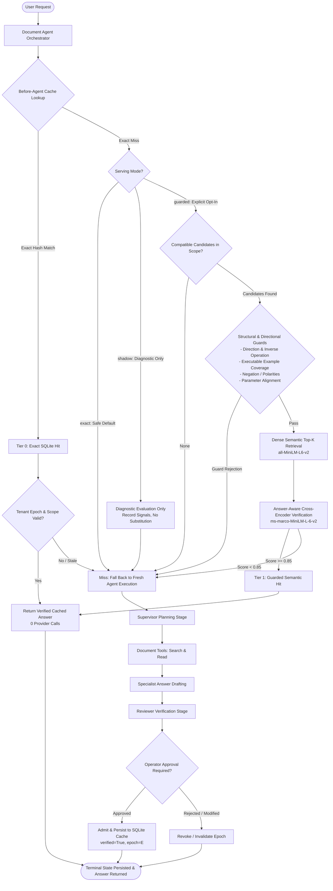

# Adaptive Agentic Semantic Cache

[](https://www.python.org/)
[](https://opensource.org/licenses/MIT)
[](tests/)
[](artifacts/resume/)
[](docs/CURRENT_STATUS.md)

> **An evaluated prototype hybrid caching gateway and autonomous documentation agent** combining exact hash lookups, structural constraint guards, and cross-encoder answer verification with evaluated engineering guardrails and experimental semantic applicability.

---

## Release Status & Safe Serving Architecture

> [!IMPORTANT]
> **Evaluated Prototype with Experimental Semantic Serving:**
> This system is an evaluated engineering prototype. Exact caching is the safe default serving configuration (`mode="exact"`). Automatic neural semantic reuse operates in shadow mode by default (`mode="shadow"`), evaluating candidates and populating diagnostic traces without substituting unproven answers. Guarded semantic serving (`mode="guarded"`) is strictly an experimental opt-in for controlled demonstrations and evaluations.

### Safe Release Configuration
1. **Tier 0 (Safe Default Exact Cache):** Immediate O(1) SQLite lookup for identical requests bound to tenant epoch, source revision, and runtime parameters. Serves cache hits with zero provider calls.
2. **Structural & Directional Guards:** Fast, deterministic checks for inverse operations, directional conversions, numeric/version constraints, and explicit executable-example requirements before neural inference.
3. **Shadow-Only Diagnostic Evaluation:** Neural candidate search and cross-encoder scoring run in diagnostic shadow mode by default, recording verification signals without substituting cached answers for live responses.
4. **Experimental Guarded Serving (Explicit Opt-In):** Dense top-k retrieval (`all-MiniLM-L6-v2`) combined with cross-encoder passage verification (`ms-marco-MiniLM-L-6-v2`) on actual returned answers, available strictly through explicit configuration for demonstrations.
5. **Verified Admission & Durable Invalidation:** Answers enter the serving cache only after verified workflow review and operator approval. Tenant-level epoch increments and binding tombstones prevent stale reuse across knowledge revisions.

---

## Independent P2 Frozen Neural Evaluation Findings

Independent frozen P2 neural evaluation was executed against checkpoint `4f9858e` by ChatGPT Work using real local neural inference (DenseEncoder + LocalPassageScorer):

- **Evaluation Workload:** 144 requests across 12 documentation groups.
- **Semantic Accepts:** 25 semantic answers accepted by cross-encoder threshold.
- **Provisional Sufficiency:** 16 / 25 accepts (64.0%, exact 95% Clopper-Pearson CI [42.5%, 82.0%]) provisionally sufficient under model-assisted review.
- **Insufficient Accepts:** 9 / 25 accepts (36.0%, exact 95% Clopper-Pearson CI [18.0%, 57.5%]) insufficient under model-assisted review.
- **Failure Root Causes:** 7 failures involving missing explicitly requested executable examples; 2 failures involving wrong-operation reuse (e.g. inverse operations).
- **Scope Challenges:** 0 hits across 60 scope challenges (0.0%, exact 95% Clopper-Pearson CI [0.0%, 6.0%]).
- **Assessment:** Failed safety qualification, not a production precision result. There is no claim of 98% precision, independent human truth, or live API monetary savings. Neural relevance scores are treated as uncalibrated relevance signals rather than guarantees of correctness.

---

## Synthetic Benchmark Impact (Offline Simulation)

Across standardized 24-task whole-agent workloads encompassing supervisor planning, document tool reads, draft generation, reviewer verification, and terminal SQLite state persistence under reference replay:

| Workload Profile *(Synthetic Reference)* | Arm | Provider Calls | Calls Avoided | Token Savings *(Offline)* | Whole-Agent p50 Latency | Opportunity Coverage | Adversarial False Hits |
| :--- | :--- | :---: | :---: | :---: | :---: | :---: | :---: |
| **Realistic Mixed Traffic**<br>*(6 seeds, 6 exact repeats, 6 safe paraphrases, 6 adversarial)* | **No Cache**<br>**Exact Only**<br>**Verified Semantic (Opt-In)** | 72<br>57<br>**45** | 0<br>15<br>**27** | 0%<br>20.7%<br>**37.7%** | 133.4 ms<br>136.7 ms<br>**122.4 ms** | 0% / 0%<br>83.3% / 0%<br>**83.3% / 66.7%** | 0.0%<br>0.0%<br>**0.0%** |
| **Repeat-Rich Traffic**<br>*(3 seeds, 10 exact repeats, 9 safe paraphrases, 2 adversarial)* | **No Cache**<br>**Exact Only**<br>**Verified Semantic (Opt-In)** | 72<br>42<br>**18** | 0<br>30<br>**54** | 0%<br>41.5%<br>**75.1%** | 144.2 ms<br>134.1 ms<br>**43.9 ms** | 0% / 0%<br>100% / 0%<br>**100% / 88.9%** | 0.0%<br>0.0%<br>**0.0%** |

*Note: Telemetry recorded from reproducible offline reference agent simulation (`runs/whole_agent_benchmark_results.json`). Offline provider call reductions and token counts are synthetic simulation metrics and are distinct from live monetary billing receipts.*

---

## Architecture & Data Flow



---

## Quickstart & Verification Demo

### 1. Environment Setup

```bash
# Clone repository
git clone https://github.com/paridhik11/adaptive-agentic-semantic-cache.git
cd adaptive-agentic-semantic-cache

# Create and activate virtual environment
python -m venv .venv
source .venv/bin/activate  # On Windows: .venv\Scripts\activate

# Install dependencies (development & test)
pip install -e ".[dev]"
```

### 2. Run the Flagship Verification Demo (7 Scenarios + Evidence Reporting)

Run the automated CLI demo to witness the 7 lifecycle execution scenarios followed by the Criterion 8 evidence summary table:

```bash
# Safe default exact-only serving demo (semantic answers never substituted)
python scripts/run_demo.py --cli

# Experimental guarded semantic reuse demo (controlled opt-in)
python scripts/run_demo.py --cli --experimental-semantic
```

**Lifecycle Execution Scenarios Validated:**
1. **Fresh Request:** Passes through supervisor planning, tool retrieval, drafting, and reviewer verification (3 provider calls, status `AWAITING_APPROVAL`).
2. **Operator Approval & Admission:** Operator approves draft; admitted to durable SQLite storage (`COMPLETED`, 0 provider calls).
3. **Safe Default Exact Repeat:** Immediate Tier 0 exact hit under default configuration (0 provider calls, 3 calls avoided, ~45 ms).
4. **Paraphrase Query Behavior:**
   - Under default exact serving (`python scripts/run_demo.py --cli`): Paraphrase query misses and runs fresh execution without substituting experimental semantic answers (3 provider calls, avoided 0).
   - Under experimental opt-in (`--experimental-semantic`): Guarded semantic hit via cross-encoder answer verification (0 provider calls, avoided 3 calls, ~116 ms).
5. **Changed Requirement (Fail Closed):** Direction reversal and inverse operations rejected by structural guard; fails closed to fresh execution (3 provider calls).
6. **Scope Invalidation:** Tenant epoch incremented; subsequent request safely misses and runs fresh work (3 provider calls).
7. **Restart Persistence:** Clean agent instance re-initialized from SQLite databases; verified answers survive process restarts with zero corrupt state.

**Criterion 8 (Evidence Reporting):**
The demo concludes with a per-request verification receipt table detailing cache tiers, timings, provider calls, and decisions across all 7 scenarios.

### 3. Launch Local Web Workbench

To interact with the visual documentation assistant:

```bash
# Default safe exact serving mode
python scripts/run_demo.py

# Optional: Opt-in to experimental guarded semantic reuse
python scripts/run_demo.py --experimental-semantic
```
Open [http://127.0.0.1:8765](http://127.0.0.1:8765) in your browser.

---

## Benchmarking & Reproducibility

Reproduce all end-to-end efficiency benchmarks on matched arms (`no_cache`, `exact_only`, `verified_semantic`):

```bash
# Run both realistic mixed and repeat-rich workloads
python scripts/benchmark_whole_agent.py --workload both

# Or evaluate a specific workload profile
python scripts/benchmark_whole_agent.py --workload mixed
python scripts/benchmark_whole_agent.py --workload repeat_rich
```

### Latency Optimization (P4 Milestone)

Profiling revealed that unoptimized hybrid misses incurred a ~60 ms overhead from unconditional dense embedding generation (~28 ms) and cross-encoder scoring (~32 ms). 

Three narrow, safety-preserving optimizations were implemented:
1. **Candidate Presence Pre-check:** Checks for valid, unexpired candidates in the current tenant epoch before calling neural encoders, dropping candidate-empty miss overhead to 0.01 ms.
2. **Cheap Structural Guards Pre-filtering:** Filters candidates by model match, response format, and history length before dense top-k retrieval.
3. **Thread-Safe LRU Embedding & Score Cache:** Bounded in-memory caching for query embeddings and passage scores.

**Result:** On repeat-rich traffic, whole-agent p50 latency decreased from 144.2 ms (`no_cache`) to **43.9 ms** (a 69.6% end-to-end reduction), while semantic hit latency clocked at **26.2 ms**.

---

## Live Provider Evaluation (Opt-In Safety Boundary)

A hermetic runner is provided for live API benchmarking against free-tier upstream providers:

```bash
# Safety check mode (default: spend cap $0.00, zero live calls made)
python scripts/run_live_benchmark.py --check-only

# Opt-in live execution (strictly requires explicit flag, spend cap, and existing journal)
python scripts/run_live_benchmark.py --execute-live --spend-cap 0.00 --agent-workflow
```

**Safety Invariants & Safeguards:**
- Outbound requests are strictly allowlisted; paid fallbacks and caller-controlled routing parameters are rejected.
- Only free-tier models are allowlisted (`nvidia/nemotron-3-super-120b-a12b:free`, `meta-llama/llama-3.2-3b-instruct:free`).
- Zero-output ceiling safeguard: `max_output_tokens <= 0` is rejected during preflight and request sanitization.
- No live calls are made without explicit user instruction, spend cap, and valid environment credentials.

---

## Verified Limitations & Boundary Declarations

To maintain strict scientific and technical honesty:
- **Evaluated Prototype with Experimental Serving:** The system is an evaluated prototype. Following the independent P2 frozen evaluation (16/25 provisionally sufficient, 9 insufficient, 0/60 scope challenges), automatic semantic reuse operates in shadow mode by default, and guarded semantic serving is available strictly as an experimental opt-in.
- **No 98% Precision Claim:** Relevance scores produced by local cross-encoders are treated as uncalibrated relevance signals rather than certified precision guarantees.
- **Offline Simulation vs Live Billing:** Provider call reductions and token savings in the benchmark tables reflect counted agent stage events under deterministic reference replay; they are not billable invoice receipts.
- **Model-Assisted vs Independent Human Ground Truth:** Model-assisted source reviews are recorded as diagnostic evidence; they do not represent independent human truth.
- **Fail-Closed Fallback:** Any uncertain request, parameter mismatch, or revoked tenant epoch immediately falls back to fresh agent execution.

---

## Testing & Quality Assurance

Run the comprehensive test suite:

```bash
# Acceptance and release correction suites
pytest tests/test_release_correction.py tests/test_p1_acceptance.py tests/test_hybrid_cache.py

# Complete agent and workbench tests
pytest tests/test_workbench.py tests/test_semantic_preparation.py tests/test_before_agent_cache.py

# Integration smoke tests
python scripts/smoke_workbench.py
python scripts/smoke_document_agent.py
```

---

## Release Checklist & Tested Commit

- [x] Evaluated prototype release with experimental semantic serving; no unverified production claims.
- [x] Safe default exact-only serving configuration (`mode="exact"`).
- [x] Automatic neural semantic reuse shadow mode (`mode="shadow"`) for diagnostic logging without answer substitution.
- [x] Targeted semantic guardrails: executable example requirement/answer coverage and direction/inverse operation compatibility.
- [x] Complete whole-agent timing boundary (planning, tools, drafting, reviewer check, approval, admission, terminal SQLite persistence).
- [x] Atomic revalidation under lock for tenant epochs, scopes, TTL, and tombstones.
- [x] Latency optimization eliminating candidate-empty miss overhead.
- [x] Reproducible 7-scenario flagship verification demo with Criterion 8 evidence summary (`scripts/demo_flagship.py`).
- [x] Matched efficiency benchmarks across mixed and repeat-rich synthetic workloads.
- [x] Strict opt-in live runner with zero-output ceiling check; zero live calls executed.
- [x] 100% passing acceptance and regression test suites.

