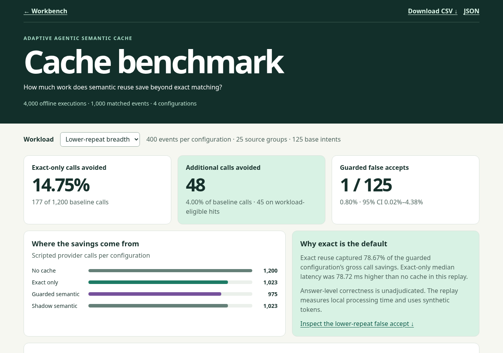

# Adaptive Agentic Semantic Cache | Interview V1

**Decision.** Keep exact reuse as the default. The exact cache captures most scripted call savings in both matched workloads. Guarded semantic reuse adds potential savings on broader traffic and accepted one request whose cached answer missed an added requirement.



## Run the demo

Use Python 3.11 or newer. The offline path was verified with Python 3.12.14. From the release checkout:

```bash
python -m venv .venv
source .venv/bin/activate
python -m pip install -r deploy/requirements-gateway.txt
python scripts/run_demo.py --whole-answer-cache --task-memory --directory .venv/interview-state
```

In Windows PowerShell, activate with `.venv\Scripts\Activate.ps1`. Open [the local workbench](http://127.0.0.1:8765/) or go straight to [the benchmark](http://127.0.0.1:8765/benchmark/). Use a fresh state directory for the first-run demo. No API key or model weights are needed.

1. Ask **How do I convert between tuples and lists?** In a fresh directory, planning, drafting and review use **3 scripted calls**. Approve the answer.
2. Select **Ask this again**. The whole approved answer is reused with **0 scripted calls**. The activity timeline identifies the reuse, and the repeated answer still waits for your approval. The default launcher without `--whole-answer-cache` demonstrates the distinct draft-only path, where the repeat uses **2** calls.
3. Ask **How do I convert between tuples and lists without using a built-in constructor?** The changed request triggers fresh processing and **3 scripted calls**. To show invalidation, clear **Manage task context** and ask the original question again.
4. Open **Benchmark analysis**. Compare workloads, switch the latency path from all requests to hits or misses, and inspect the cProfile failure.

For the model-free CLI lifecycle check:

```bash
python scripts/run_demo.py --cli --directory .venv/interview-cli
```

## What the data says

| Offline workload | Events per arm | No cache calls | Exact-only calls | Guarded calls | Exact call reduction | Exact synthetic token reduction | Guarded incremental calls avoided |
| --- | ---: | ---: | ---: | ---: | ---: | ---: | ---: |
| Repeat-heavy | 600 | 1,800 | 948 | 927 | **47.33%** | **46.57%** | **21** (1.17% of baseline) |
| Lower-repeat breadth | 400 | 1,200 | 1,023 | 975 | **14.75%** | **14.56%** | **48** (4.00% of baseline) |

The 600 and 400 workload events were each replayed across four configurations, yielding **4,000 executions**. The repeat-heavy workload spans 12 source groups. The breadth workload spans all 25. Shadow serving matched exact-only call totals and did not substitute semantic answers.

On the breadth workload, 45 of the additional 48 calls avoided were on workload-eligible hits. The other three came from the false accept below. Eligibility is defined by the fixture and does not establish answer correctness. The campaign contains zero independently reviewed accepts, so the answer-level incorrect reuse rate is unavailable. The repeat-heavy guarded result of 0/120 adversarial accepts is development regression evidence, with an exact 95% interval of 0.00%–3.03%. The breadth guarded result is 1/125 (0.80%, exact 95% interval 0.02%–4.38%). Related requests cluster within intents and source groups, so these intervals are descriptive under the binomial assumption.

Exact-only median replay latency rose from **130.86 to 140.80 ms** on repeat-heavy and **89.70 to 168.42 ms** on breadth. This benchmark counts scripted calls and synthetic tokens and records historical local wall time. The results support a work-avoidance claim under the tested traffic mixes. A representative paired live study would be needed to quantify application speed or billable savings.

## Inspect one failure

In [the lower-repeat log](../artifacts/metrics_campaign/lower_repeat/offline_results.jsonl), search for `async_05:challenge_added_requirements`. Guarded semantic served a cached asyncio overview with no cProfile benchmarking. Exact-only fell back to three scripted calls. The event retains the matched prompt, returned answer and terminal decision. The historical guard decisions and cross-encoder score for this event were not captured.

The [development guard experiment](../scripts/interview_guard_experiment.py) replays the recorded prompt, candidate and answer through today's requirement checks. They allow the pair to proceed. A proposed cProfile check flags the added requirement and also catches an answer omitting cProfile when both prompts ask for it.

| Requirement-stage development cases | Cases | Current allowed through | Proposed allowed through |
| --- | ---: | ---: | ---: |
| Known campaign failure | 1 | 1 | 0 |
| Authored equivalent requests | 2 | 2 | 2 |
| Authored omission control | 1 | 1 | 0 |

This stage-level experiment changes no serving policy. Retrieval, verifier scores, net calls and latency were outside its scope. A fresh intent-grouped test would be needed to assess generalization and false rejections.

## Reproduce the results

```bash
python -m pip install 'scipy>=1.10,<2'
python scripts/report_interview.py
python scripts/report_interview.py --check
python scripts/interview_guard_experiment.py
```

The report validates unique event IDs, one-to-one arm coverage, request metadata, manifest counts and logged calls avoided against each paired baseline. The dashboard reads [generated JSON](../dashboard/interview/report.json) and provides the same [comparison data as CSV](../dashboard/interview/comparison.csv). The JSON includes log SHA-256 hashes, counts, exact intervals, and p50/p95 by hit and miss path. Percentiles follow the original campaign convention. For fewer than 20 observations, p95 is reported as the sample maximum.

| Repository area | Contents |
| --- | --- |
| [src/agents](../src/agents) and [src/policy](../src/policy) | Agent lifecycle, cache serving, guard and approval logic |
| [src/api](../src/api) and [dashboard/interview](../dashboard/interview) | Workbench and benchmark views |
| [artifacts/metrics_campaign](../artifacts/metrics_campaign) | Committed evidence by workload |
| [scripts/report_interview.py](../scripts/report_interview.py) | Reconciliation and report generation |
| [tests/test_interview_report.py](../tests/test_interview_report.py) | Alignment, published metrics and workbench integration checks |

## Interview summary

> I evaluated four cache configurations on 1,000 matched requests. Exact caching cut scripted calls by 47.33% on repeat-heavy traffic and 14.75% on broader traffic. I isolated the incremental gain from semantic matching, then traced a false accept to an added profiling requirement. That trade-off is why I kept exact reuse as the default. I also measured end-to-end replay latency and found that fewer calls did not guarantee a faster request.
