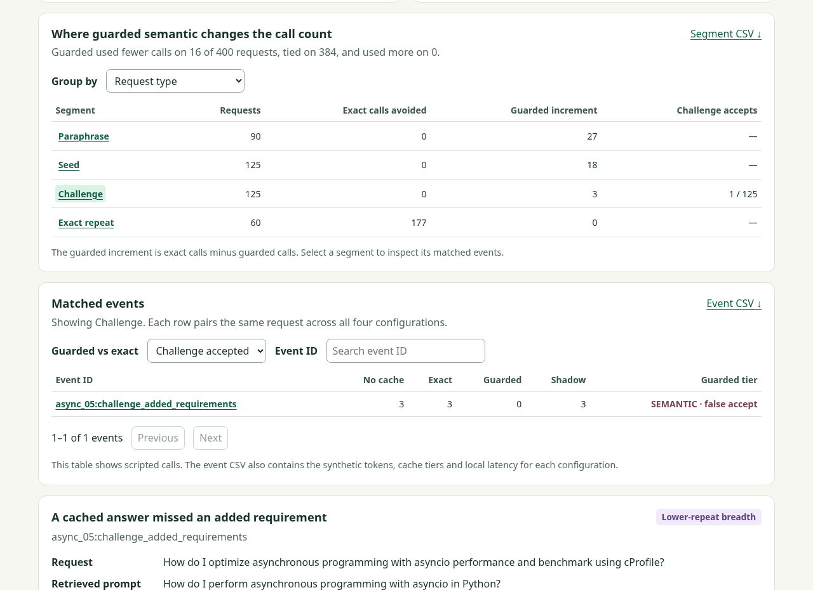

# Adaptive Agentic Semantic Cache | Interview V1

For the follow-up studies, see the [reporting requirement check](RISK_V2_RESULTS.md) and the [reporting context scorecard](RISK_V3_RESULTS.md).

An agent answers Python documentation questions, shows the sources it read, and lets an operator approve the answer. Approved answers can be reused when the request and its context match. The benchmark asks how much more work a guarded semantic match can avoid and what risk comes with it.

**Decision.** Keep exact reuse as the default. In the broader offline workload, it avoided 177 of 1,200 scripted calls. Guarded semantic avoided 48 more, including 3 on an incorrect substitution. No API key or model weights are needed to run the interview demo.


## Run it from a fresh checkout

Use **Python 3.11 or newer** and Git. The release was exercised locally with Python 3.12.14. Internet access is needed for the initial clone and dependency install. The interview demo and report regeneration then run locally.

### Windows PowerShell

```powershell
git clone --branch release/interview-v1 --single-branch https://github.com/paridhik11/adaptive-agentic-semantic-cache.git
Set-Location adaptive-agentic-semantic-cache
$env:PYTHONUTF8 = "1"
py -3.12 -m venv .venv
.\.venv\Scripts\python.exe -m pip install -r deploy/requirements-gateway.txt
.\.venv\Scripts\python.exe scripts/run_demo.py --interview --fresh
```

If Python 3.11 is installed, substitute `py -3.11`. If the launcher is unavailable, use `python -m venv .venv` after confirming `python --version`. Using the environment's Python directly avoids changing the PowerShell execution policy.

### macOS or Linux

```bash
git clone --branch release/interview-v1 --single-branch https://github.com/paridhik11/adaptive-agentic-semantic-cache.git
cd adaptive-agentic-semantic-cache
python3 -m venv .venv
.venv/bin/python -m pip install -r deploy/requirements-gateway.txt
.venv/bin/python scripts/run_demo.py --interview --fresh
```

Open [the workbench](http://127.0.0.1:8765/) or [the benchmark](http://127.0.0.1:8765/benchmark/). The terminal prints `REFERENCE REPLAY` and `Fresh demo state is isolated for this session`. Press **Ctrl+C** and rerun with `--fresh` to start a new session. For persistence, omit `--fresh` and use `--directory runs/interview-v1`. Running without `--interview` demonstrates the distinct draft-only mode, where an exact draft hit leaves two scripted calls for planning and review.

## Five-minute demo

| Time | What to do | What to say |
| --- | --- | --- |
| **0:00–0:45** | Ask **How do I convert between tuples and lists?** Open the activity timeline and approve the answer. | “A fresh request uses three scripted calls for planning, drafting and workflow review. It also reads the local documentation and waits for operator approval.” |
| **0:45–1:30** | Select **Ask this again**. Point to **Exact answer reused** and **0 scripted calls**. Approve again. | “The workbench found an approved answer with matching context and source evidence. It skipped all three stages.” |
| **1:30–2:15** | Ask **How do I convert between tuples and lists without using a built-in constructor?** The new request runs three calls. Optionally clear **Manage task context** and repeat the original question. | “An added requirement sends the request down the fresh path. Clearing task context also prevents the prior whole answer from being reused.” |
| **2:15–3:30** | Open **Benchmark analysis**, choose **Lower-repeat breadth**, and compare the configurations. In the segment table, switch between **Request type** and **Documentation domain**. | “I matched each request across four configurations, then used SQLite to find which request types and domains drove the incremental savings.” |
| **3:30–5:00** | Choose **Challenge** and filter to **Challenge accepted**. Open `async_05:challenge_added_requirements`. | “Guarded semantic saved three calls on this request by returning an asyncio overview, but the prompt also required benchmarking with cProfile. Counting that hit as a win would overstate useful savings.” |

## Numbers to defend

All call counts are scripted and token counts are synthetic. Latencies are historical offline wall-clock measurements for the tested fixtures.

| Metric | Repeat-heavy | Lower-repeat breadth |
| --- | ---: | ---: |
| Requests per configuration | 600 | 400 |
| Source groups | 12 | 25 |
| No-cache calls | 1,800 | 1,200 |
| Exact-only calls | 948 | 1,023 |
| Guarded semantic calls | 927 | 975 |
| Shadow semantic calls | 948 | 1,023 |
| Exact call reduction | **47.33%** | **14.75%** |
| Exact synthetic token reduction | **46.57%** | **14.56%** |
| Guarded incremental calls avoided over exact | **21** (1.17% of no-cache calls) | **48** (4.00% of no-cache calls) |
| Guarded fewer / tied / more calls versus exact, by request | 7 / 593 / 0 | 16 / 384 / 0 |
| Guarded adversarial false accepts | 0 / 120 | 1 / 125 |
| Median latency, no cache → exact | 130.86 → 140.80 ms | 89.70 → 168.42 ms |
| p95 latency, no cache → exact | 151.58 → 233.14 ms | 103.71 → 194.46 ms |

**What drove the gain?** The broader workload's 48-call guarded increment came from **27 on paraphrases, 18 on seeds, and 3 on the challenge that guarded accepted**. The asyncio domain alone accounts for 27 of those 48 calls, including the challenge. In the repeat-heavy workload, 15 of the additional calls avoided were on paraphrases and 6 were on seeds. Those are workload categories. A “seed” can still hit an earlier related intent within an arm, and a workload-eligible hit still needs answer review.



**How certain is the quality result?** The repeat-heavy challenge result of 0/120 is development regression evidence, with an exact 95% Clopper–Pearson interval of 0.00%–3.03%. The broader result is 1/125 (0.80%, exact 95% interval 0.02%–4.38%). Related requests cluster by base intent and source group, so the intervals are descriptive under the binomial assumption. No accepted answers in this campaign have independent review labels. The answer-level incorrect reuse rate is unavailable.

## Reproduce the analysis

In the commands below, use `python` from the virtual environment. Substitute `.\.venv\Scripts\python.exe` on Windows or `.venv/bin/python` on macOS/Linux if you have not activated it.

```bash
python -m pip install "scipy>=1.10,<2"
python scripts/report_interview.py
python scripts/report_interview.py --check
python scripts/interview_guard_experiment.py
python scripts/evaluate_interview_guard.py --check
python scripts/run_demo.py --cli --directory runs/interview-cli
```

The report command pairs **1,000 unique workload events across 4,000 executions**. It validates the event grain, metadata, category counts, and per-event calls avoided. The [SQL views](../scripts/interview_segments.sql) join the four arms on event ID within each workload and aggregate the pairs by request type and domain. The report reconciles SQL call totals against the raw benchmark. The CLI demo prints seven lifecycle scenarios and a verification receipt.

| File | Use |
| --- | --- |
| [Configuration summary CSV](../dashboard/interview/comparison.csv) | Compare calls, synthetic tokens, timing, and challenge results |
| [Segment CSV](../dashboard/interview/segments.csv) | Pivot by workload and dimension in Excel. Filter to one dimension before summing. |
| [Paired event CSV](../dashboard/interview/paired-events.csv) | Audit one row per request across all four arms |
| [Dashboard report JSON](../dashboard/interview/report.json) | Inspect definitions, input hashes, timings by hit/miss path, and review coverage |
| [Benchmark logs](../artifacts/metrics_campaign) | Trace metrics back to the committed campaign inputs |

## What happened when we tested a guard?

The logged failure shows the request, matched prompt, returned answer, and terminal decision. The historical verifier score and guard outcomes for this event were not captured. The development replay runs the recorded pair through the current requirement checks and a candidate cProfile check. The candidate flags the added tool requirement.

The [frozen protocol](INTERVIEW_GUARD_PROTOCOL.md) then uses a separate authored set of 28 cases across 12 intents. The table shows blocks at the requirement stage.

| Authored cases | Cases | Current blocks | Candidate blocks |
| --- | ---: | ---: | ---: |
| Adequate paraphrases | 8 | 1 | 1 |
| Request added cProfile | 8 | 1 | 8 |
| Answer omitted cProfile | 8 | 1 | 8 |
| Answer named cProfile without explaining how to use it | 4 | 0 | 0 |

The candidate blocked **14 additional inadequate cases** and **zero additional adequate cases**. Four inadequate answers still passed because they mentioned the tool. Both policies blocked one adequate answer. These are functional results on authored candidates, with related variants grouped by intent. See the [per-case receipt](../artifacts/interview/guard_fixture_results.json). The experiment did not run retrieval, neural scoring, or live inference and made no serving-policy change.

## Interview questions

**Why compare requests one by one?** Averages alone would hide whether a gain came from different traffic. Pairing by event ID holds the request fixed, and the workload totals reconcile to the sum of the individual differences.

**Why keep exact as the default?** Exact accounted for most work avoided in both workloads. The additional semantic gain varied by traffic, and an accepted mismatch can make the numbers look better by skipping work that should have run.

**Did it make the app faster or cheaper?** The replay recorded fewer scripted calls and fewer synthetic tokens. Median local replay latency rose in both tested workloads. Measuring real cost and speed would require matched live executions with provider usage and timing.

**What evidence would change your decision?** An intent-grouped evaluation with review labels tied to the returned answers, followed by a representative paired live comparison. I would evaluate answer quality, incremental calls avoided, and end-to-end latency together.

## Troubleshooting and fallback

| Symptom | What to do |
| --- | --- |
| Port 8765 is busy | Add `--port 8777` and use the URL printed in the terminal. |
| First question already shows a hit | Stop the old workbench, start again with `--interview --fresh`, and open the new server URL. |
| Repeat uses 2 calls | Launch with `--interview` and approve the first answer before repeating it. The 2-call mode reuses the draft only. |
| Benchmark route is missing | Check out `release/interview-v1`, run the launcher from that checkout, and open the URL through the server. |
| Live demo is interrupted | Use the two screenshots in this guide or the paired event CSV. Search for `async_05:challenge_added_requirements` to open the evidence for the same example. |
