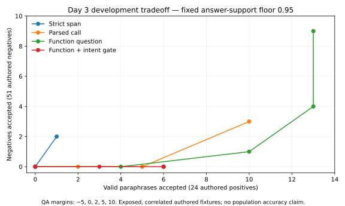

# Day 3: research, candidate policies and error analysis

October 21, 2026. **Quality status: blocked. No candidate is qualified for general serving.**

The research and development measurement deliverables are implemented. The
core quality blocker is not resolved: none of the fixed QA grid points jointly
accepts at least 30% of authored positives and zero authored negatives. These
are descriptive development screens, not the independently reviewed final gate.
Do not mark all Day 3 errors solved or advance into Day 4 selection/calibration.

## Research and implemented experiments

See the [prospective protocol and primary sources](../DAY3_RESEARCH_AND_PROTOCOL.md).
The design synthesis distinguishes retrieval, answerability, source support and
intent preservation. GPTCache/vCache/Krites provide useful architecture and
feedback ideas; they do not supply our missing actual-answer labels. QA-based
consistency research motivated the local extraction experiments, not a claim
that its published results transfer to this cache.

Pinned local SQuAD2 MiniLM extracts source answers to the original/incoming
questions and an answer from the actual cached response. Pinned DeBERTa checks
every answer claim against context. Existing full request/context scope and
explicit requirement guards remain. The application policy always abstains.
Only an isolated socket-blocked fixture adapter maps recommendations to cache
decisions. There is no pair allowlist or production enable switch.

## Comparable development counts

All new QA variants use the same 75 cases: 24 positives, 51 negatives, 23
correlated intent groups. The existing 45 cases remain unchanged; 30 additional
builder-authored cases are broader development, not a sealed or independent set.
Initial settings are QA margin 0 and NLI support 0.95; the hybrid also requires
bidirectional intent entailment at 0.95. No threshold was selected from the curve.

| Variant | Valid accepts / 24 | Negative accepts / 51 | Old positives / 14 | New positives / 10 | Actual semantic hits (unsafe) / 75 |
| --- | --- | --- | --- | --- | --- |
| Strict QA span | 0 | 0 | 0 | 0 | 0 (0) |
| Parsed Python-call anchor | 5 | 0 | 2 | 3 | 4 (0) |
| Function-question rewrite | 13 | 4 | 6 | 7 | 7 (2) |
| Rewrite + intent gate | 6 | 0 | 2 | 4 | 4 (0) |

The prior NLI baseline remains 2/14 positives and 0/31 negatives on the old
45 cases; its recovered full-score replay reproduced those counts. Do not compare
2/14 with 6/24 as if the cohort were unchanged. The hybrid still accepts only
2/14 on the old positive cohort, with 4/10 on additional authored positives.

All cache experiments also reused one deliberately bad complete seed through
exact matching. This is independent of semantic approval: complete response
admission certifies neither factual correctness nor sufficiency. Each variant
uses fresh fixture caches, so these replays are not independent quality trials.



The [aggregate artifact](DAY3_POLICY_RESULT.json) contains all 25 points per QA
variant and lossless raw archive hashes. Curves describe the decision policy
given a candidate, excluding candidate retrieval. Actual cache outcomes apply
the separate dense retrieval gate (cosine 0.80, margin 0.05). Local timings are
diagnostic; setup and per-check work are recorded, not a paired application
latency/cost benchmark. Generation calls: zero. Independent human reviews: zero.
No population precision intervals are reported for purposive correlated fixtures.

## Errors and their disposition

| Failure | Evidence / disposition |
| --- | --- |
| Procedural QA returns inconsistent or wrong spans | Strict QA accepts no positives. Parsed-call anchors correct boundary differences but not incorrect extraction. Unresolved model suitability. |
| Answerability confused with intent | Function rewrite accepts 4 changed-task negatives; 2 become unsafe fixture hits. Variant rejected. |
| Conservative intent NLI rejects paraphrases | Hybrid removes observed unsafe accepts, but only 6/24 positives pass. Unresolved coverage. |
| Supported fact can be insufficient for the question | Source-claim support alone cannot authorize reuse. All policy components and actual-answer bindings retained. Unresolved general sufficiency. |
| Explicit guard overrejects semantic equivalents | For example, an absolute-value paraphrase introduces “without its sign”; the negation guard rejects it. Do not add a per-question exception. |
| Early exits hid later failures | Restored development full-score mode; first rejection remains binding and all later NLI attempts count. Existing production behavior unchanged. |
| Evidence files could be overwritten | Runners now refuse existing paths before model preparation and use exclusive creation. Verified existing bytes remain unchanged. |
| Removing whitespace could merge words or numbers | Span comparison now tokenizes without concatenating separate words/numbers. Final focused test covers “1 0” versus “10”. All 232 recorded QA triplets retain the same agreement decisions. |
| Exact cache repeats a factually bad seed | Preserved as an admission-quality boundary; no claim that exact caching repairs bad generation. Needs explicit answer provenance/admission design. |

## Next work and Day 10 delivery

Keep work on Day 3 quality. The next substantive route is a cache-specific
actual-answer applicability classifier or structured requirement checker, developed
with group-disjoint question/answer examples and changed-task counterexamples.
Use this study as exposed development data only. Generic relevance, source support
or a different global threshold cannot be substituted for an applicability label.
No further model shopping is justified without that data/task design.

Before choosing a version for Day 4, demonstrate useful development coverage
without the observed unsafe-acceptance mechanisms, then calibrate on separate
groups. Independent reviewers and final cohort size remain unresolved. Day 10
is the product-delivery target, not a promise of a passed quality gate. Website,
live comparison and performance claims cannot replace the missing semantic core.

## Reproduce and inspect

Artifacts in `day3/*.json.gz` preserve complete authored responses, per-check
scores, bindings, work and cache traces. They contain no user-provided private
answers or human review mappings. The earlier unpushed full-score scratch artifact
was removed by workspace maintenance; the published baseline is unchanged, and
the recovery file is explicitly a new development replay, not fresh final data.

```bash
python scripts/probe_question_conditioned.py --prepare --output runs/semantic-dev/qa-strict-new.json
HF_HUB_OFFLINE=1 TRANSFORMERS_OFFLINE=1 python scripts/probe_question_conditioned.py --span-mode api-anchor --output runs/semantic-dev/qa-anchor-new.json
HF_HUB_OFFLINE=1 TRANSFORMERS_OFFLINE=1 python scripts/probe_question_conditioned.py --span-mode api-anchor --question-form function --output runs/semantic-dev/qa-function-new.json
HF_HUB_OFFLINE=1 TRANSFORMERS_OFFLINE=1 python scripts/probe_question_conditioned.py --span-mode api-anchor --question-form function --require-intent-entailment --output runs/semantic-dev/qa-hybrid-new.json
HF_HUB_OFFLINE=1 TRANSFORMERS_OFFLINE=1 OMP_NUM_THREADS=2 MKL_NUM_THREADS=2 python scripts/probe_decomposed_policy.py --collect-all-scores --output runs/semantic-dev/nli-full-new.json
python scripts/analyze_day3_policies.py
HF_HUB_OFFLINE=1 TRANSFORMERS_OFFLINE=1 python -m pytest -q
```

Install project/dev dependencies in an isolated environment first. Here, the
recovered dependencies were installed under `.venv/lib/python3.12/site-packages`
and commands used that directory in `PYTHONPATH`; exact package versions and
weight hashes are in the aggregate artifact. No generation key is required.

Full offline regression: 767 passed, 23 deselected in 118.90 seconds. The final
word-boundary hardening followed that run: 79 focused tests passed and agreement
decisions were recomputed from all 232 saved QA triplets without change.
Engineering tests do not estimate model accuracy.
